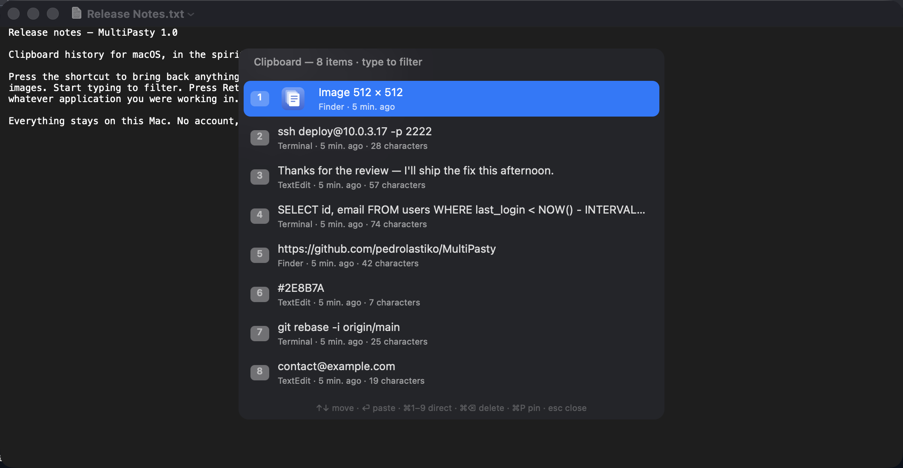
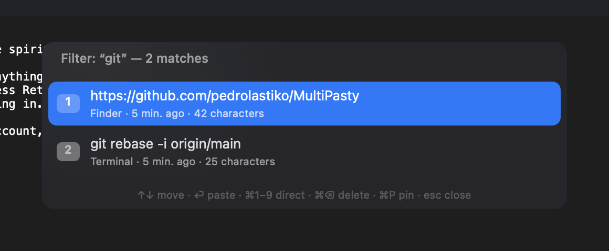
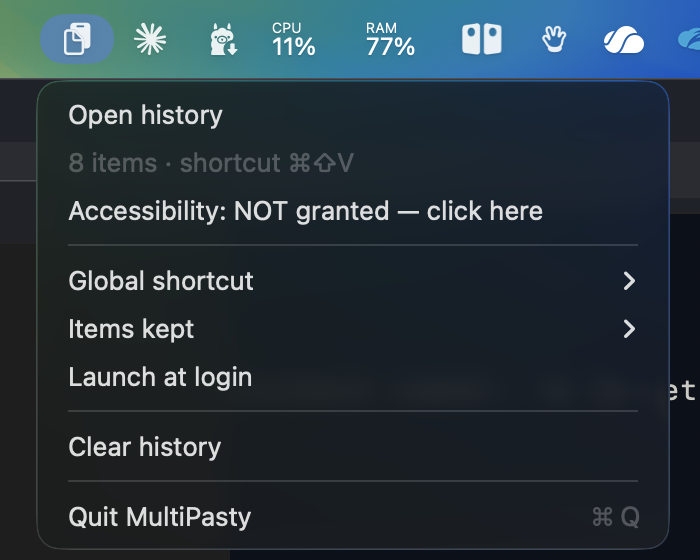

<div align="center">
  
  <h1>MultiPasty</h1>
  <p><b>Windows + V, on a Mac.</b></p>
  <p>
    
    
    
    
    
    <a href="https://github.com/pedrolastiko/MultiPasty/releases/latest"></a>
    <a href="LICENSE"></a>
  </p>
</div>

macOS remembers exactly one thing you copied. MultiPasty remembers the last
twenty — text, snippets, screenshots — and gives them back with one shortcut.
Press **⌘⇧V** anywhere, start typing to narrow the list, press **Return**: the
entry is pasted straight into the application you were already working in.

Everything stays on this Mac. No account, no sign-in, no telemetry, and no
networking code anywhere in the project.

<div align="center">
  
</div>

---

## Download

[**MultiPasty 1.0**](https://github.com/pedrolastiko/MultiPasty/releases/latest) — universal binary, 368 KB zipped.

The app is signed ad hoc and **not notarised by Apple**, so macOS quarantines it
on download and refuses the first launch. One command clears that:

```bash
# after unzipping, with MultiPasty.app in ~/Downloads
mv ~/Downloads/MultiPasty.app /Applications/
xattr -dr com.apple.quarantine /Applications/MultiPasty.app
open /Applications/MultiPasty.app
```

Check what you downloaded before you run it:

```bash
shasum -a 256 MultiPasty-1.0.zip
# 935e548e251656bbfb17c96ddd67779fedd1704b8bc0d35d59d9bb86495f3671
```

> [!NOTE]
> Notarisation requires a paid Apple Developer account, which this project does
> not have. Building from source skips the quarantine entirely, and takes about
> fifteen seconds.

## Build from source

```bash
git clone https://github.com/pedrolastiko/MultiPasty.git
cd MultiPasty
./install.sh
```

`install.sh` compiles the app, copies it into `/Applications`, clears the stale
Accessibility entry (see [Troubleshooting](#troubleshooting)) and launches it.
About fifteen seconds. You need macOS 13 or later and the Xcode command-line
tools — nothing else, there is no package to fetch.

To build without installing, run `./build.sh` and find the bundle in
`build/MultiPasty.app`. The binary is universal, Apple silicon and Intel, and
weighs around 560 KB.

MultiPasty lives in the menu bar and has no Dock icon. The interface follows
your system language: **French** or **English**.

## Permissions

| What | Needs | Why |
| --- | --- | --- |
| Remembering what you copy | nothing | any application may read the pasteboard |
| **⌘⇧V** and the panel | nothing | the shortcut is a Carbon hot key, registered system-wide |
| Pasting for you on **⏎** | Accessibility | to press ⌘V in the application you came from |

Only the last line needs a permission, and macOS asks for it on first launch.
Decline it and MultiPasty still works — your pick lands in the clipboard and you
press ⌘V yourself.

## Using it

| Key | Does |
| --- | --- |
| **⌘⇧V** | open or close the panel |
| **↑ ↓** | move through the list, which wraps around |
| **⏎** | paste the selected entry |
| **⌘1 … ⌘9** | paste the *n*-th entry directly |
| *any character* | filter, ignoring case and accents |
| **⌫** | delete the last character of the filter |
| **⌘⌫** | delete the selected entry |
| **⌘P** | pin or unpin — pinned entries stay on top and are never evicted |
| **⌘K** | clear the history |
| **esc** | clear the filter, then close |
| *click* | paste the entry you clicked |

The panel opens next to the pointer and shrinks to fit its contents.

<div align="center">
  
</div>

The menu bar icon holds the rest: the shortcut (**⌘⇧V**, **⌥V**, **⌃⌥V** or
**⌘⌥V**), how many entries to keep (10 to 100), and launch at login.

## What it keeps

- **Text** from any application. Each entry shows where it came from and when.
- **Images** — screenshots, copied pictures — with a thumbnail in the list.
- Copying something already in the history **moves it back to the top** instead
  of adding a duplicate.
- **Pinned** entries survive eviction and `⌘K`.

And what it deliberately drops: anything a password manager marks as
confidential. 1Password, and every other manager that follows the convention,
flag their pasteboard writes with `org.nspasteboard.ConcealedType`. MultiPasty
checks for that flag and never records those entries.

## Privacy

There is no networking code in this project. Not disabled, not opt-out —
absent. Nothing is collected and nothing is sent anywhere.

Your history is a plain file you can read, and delete:

```
~/Library/Application Support/MultiPasty/
├── history.json     the entries
└── Images/          copied images, as PNG
```

Clearing the history from the menu empties both.

## Troubleshooting

### "The checkbox is ticked, but the app says it is not allowed"

This is the one trap worth knowing, and it is invisible.

macOS does not grant Accessibility to *an application*. It grants it to **one
exact binary**, identified by its code hash. Rebuild the app and the hash
changes — but the old entry stays in the list, **still ticked**, now pointing at
a binary that no longer exists. `AXIsProcessTrusted()` returns `false`, the app
asks for the permission again, and System Settings insists everything is fine.

MultiPasty tells you what it actually sees, in its own menu:

<div align="center">
  
</div>

Trust that line, not the checkbox. To repair:

```bash
tccutil reset Accessibility com.pierrelecalvez.multipasty
open /Applications/MultiPasty.app
```

The stale entry disappears, the app registers itself with its current hash, and
switching it on in System Settings now binds to the binary that runs.
`install.sh` does this on every install, so a rebuild never leaves you stuck —
you only have to switch the permission back on.

> [!TIP]
> Signing the app with a stable certificate instead of ad hoc would end this for
> good: the grant would follow the certificate and survive every rebuild. Create
> a code-signing certificate in Keychain Access → Certificate Assistant, then
> replace `codesign --sign -` with `codesign --sign "<certificate name>"` in
> `build.sh`.

### The shortcut does nothing

Open the menu: the second line states which shortcut is live. Another
application may have claimed the same combination first — Carbon hot keys are
first come, first served. Pick one of the three others under **Global
shortcut**.

## Under the hood

Seven Swift files, one `swiftc` call, no package manager and no dependency
beyond the system frameworks. Around 1,260 lines.

| File | What it holds |
| --- | --- |
| `main.swift` | entry point |
| `AppDelegate.swift` | menu bar item, settings, permission state |
| `HistoryStore.swift` | model, JSON persistence, filtering, pinning |
| `ClipboardMonitor.swift` | pasteboard polling, confidential-type filtering |
| `HotKey.swift` | the global shortcut (Carbon) |
| `PopupWindow.swift` | the panel: list, keyboard handling, drawing |
| `Paster.swift` | synthesising ⌘V (CGEvent) |
| `Localization.swift` | French and English, following the system |

Three decisions worth explaining:

**Polling, not notifications.** `NSPasteboard` offers no change notification —
none, at any privilege level. Every clipboard manager on macOS polls
`changeCount`, and MultiPasty does it every 350 ms. That is frequent enough to
feel instant and cheap enough to be invisible in Activity Monitor.

**Carbon for the shortcut.** `RegisterEventHotKey` dates from the previous
century and has no modern replacement that works system-wide without asking for
Accessibility. An `NSEvent` global monitor would have needed that permission
just to notice a keystroke, so the panel would have been unreachable until the
user granted it. Carbon needs nothing.

**Waiting for focus before pasting.** Returning focus to the application you
came from is asynchronous, and it takes anywhere from 50 ms to several hundred
depending on the application. A fixed delay before synthesising ⌘V either
wastes time or drops the keystroke into the void — which is exactly what the
first version did. MultiPasty now polls `frontmostApplication` every 30 ms, up
to a second, and presses ⌘V once the target is genuinely in front.

## Planned

- [x] A downloadable build, so Xcode is not required
- [ ] Signing and notarisation, so macOS opens it without the quarantine step
- [ ] Plain-text paste, stripping formatting
- [ ] A configurable shortcut rather than four presets
- [ ] Excluding chosen applications from capture

## Licence

MIT — see [`LICENSE`](LICENSE).
